<!-- swy4x | Cybersecurity • Ethical Hacking • Blue Team -->

 

---

## ` whoami `

## ` ./arsenal.sh `

### Defensive Security

### Offensive Security & Fundamentals

### Development & Tools

Tools and technologies listed reflect hands-on lab use or current learning—not professional experience or certifications.

## ` ls -la ~/projects `

### 🛡️ Wazuh SOC Home Lab
A hands-on security monitoring environment built to explore detection, telemetry and investigation.

- Wazuh SIEM/XDR deployed with Docker
- SSH authentication monitoring and custom detection rules
- File Integrity Monitoring and EICAR test-file investigation
- Suricata IDS experiments and Zeek network telemetry
- YARA scanning and Active Response integration

## ` cat roadmap.txt `

| Track | Learning |
|:--|:--|
| Networking | TCP/IP, DNS, ports, protocols, packet analysis |
| Blue Team | SIEM, alert triage, log analysis, incident investigation |
| Offensive Security | Linux, web security, ethical hacking labs |
| Detection | Wazuh rules, Suricata signatures, YARA |
| Programming | Python fundamentals and automation |

## ` git stats `

## ` connect --with-community `

Interested in cybersecurity, ethical hacking, Linux, SOC operations and learning from the community.

 

<code>01001000 01000001 01000011 01001011</code> · Learn ethically. Build responsibly. Stay curious.

